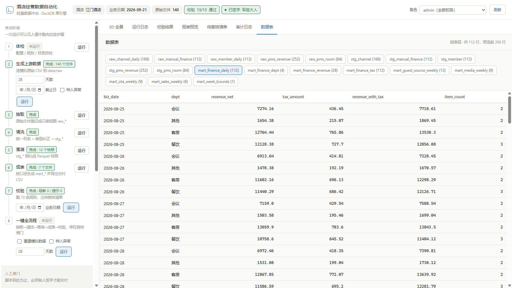
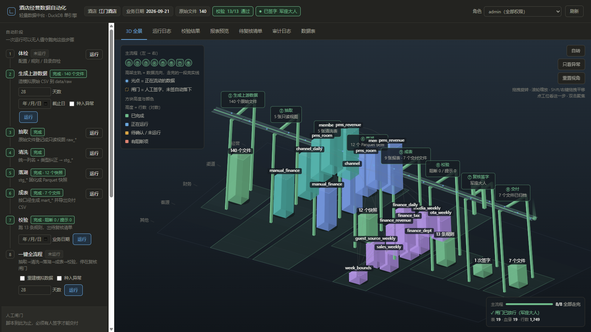
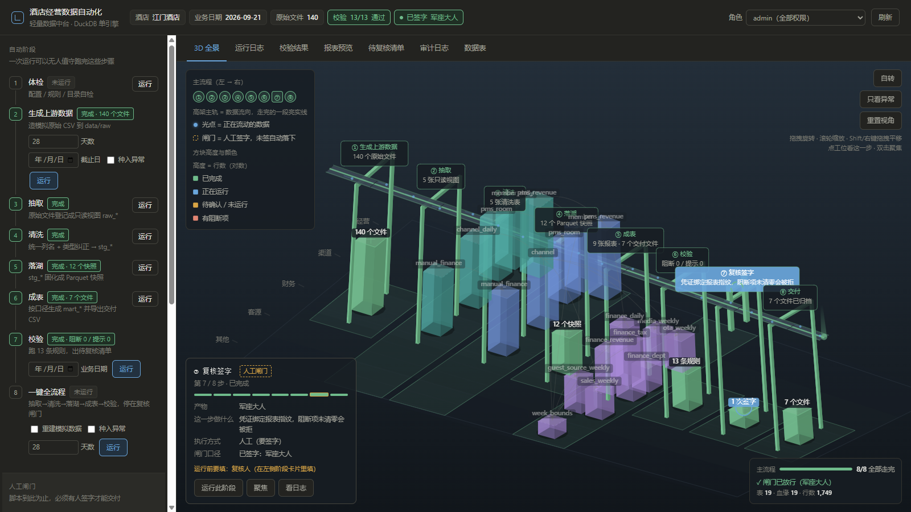

# 酒店经营数据自动化 · 轻量数据中台

把酒店分散在 **PMS / 会员系统 / OTA 后台 / 新媒体后台 / 人工财务套表** 里的经营数据，
自动汇成财务口径的日报周报，并且**每一份报表在发出去之前都必须过校验和人工签字**。

这是《酒店经营数据自动化 · 需求与实现简报》的可运行落地版本：
一个计算引擎（DuckDB）、一套规则配置（YAML）、一条六阶段管道，没有集群、没有 Spark。

---

## 它解决什么问题

简报里的现状是：3–5 人/日 重复手工取数、对口径、做表、发群。
四类痛点，代码里都有对应的应对：

| 痛点 | 在中台里的对应物 |
| --- | --- |
| 取数靠人、口径靠记忆 | `config/report_rules.yaml` 把口径写成数据，程序编译成 SQL |
| 平台字段口径不一致 | `config/columns_map.yaml` 套表统一列名；清洗层只做类型纠正不做过滤 |
| 跑错数据没人发现（静默失败） | `CMP-004 date_freshness` + `CMP-001` 等 13 条规则，阻断项直接拦交付 |
| 谁在什么时候把哪张表发给了谁，说不清 | `data/logs/audit-*.jsonl` 逐动作留痕 + 审批凭证绑定报表指纹 |

**它不替财务拍板。** 管道只做到「把口径变成可执行流程 + 把异常摆到人面前」，
审批那一步必须由 `finance_reviewer` 角色的人来完成。

---

## 快速开始

```bash
# 1) 建虚拟环境并装依赖（本机已验证 aliyun 镜像可用）
python -m venv .venv
.venv/Scripts/python -m pip install -r requirements.txt -i https://mirrors.aliyun.com/pypi/simple/

# 2) 体检：配置读得对不对、规则有没有漏实现、目录全不全
python run.py selftest

# 3) 造一批模拟上游数据，然后一路跑到「复核闸门」自动停住
python run.py pipeline --regenerate

# 4) 人工复核后签字（阻断项没清零会被拒绝）
python run.py approve --reviewer 张三

# 5) 交付：归档到微盘目录 + 企微通知（默认 dry-run，只落盘不真发）
python run.py deliver
```

想看看「规则是怎么把脏数据拦下来的」，用这个：

```bash
python run.py pipeline --regenerate --anomalies
```

会故意种入 4 处典型问题（科目缺失 / 价税不平 / 收入负数 / 环比暴涨），
然后你会在校验环节看到 3 条阻断项 + 1 条提示项，并且 `approve` 会被拒绝。

---

## 可视化控制台

不想敲命令就用它：

```bash
python run.py ui
```

浏览器会自动打开 `http://127.0.0.1:8777/`（端口被占自动顺延到 8778、8779…）。
左边是管道，一个阶段一张卡片；右边七个页签。全部功能都在这一页里：



| 页签 | 看什么 |
| --- | --- |
| **3D 全景** | 把整条流水线画成一条可旋转的线：8 个工位、上方高架主轨、走到哪了、卡在哪一步、正在跑什么 |
| 运行日志 | 点「运行」后**实时**刷出的输出，跟终端里一模一样 |
| 校验结果 | 13 条规则的逐条判定：规则号、类型、位置、级别、判定说明 |
| 报表预览 | 7 个交付 CSV 的表格预览（点文件切换） |
| 待复核清单 | 渲染好的 `待复核清单_<日期>.md`，含产物指纹（sha256） |
| 审计日志 | 谁在什么时候对哪张表做了什么，逐条可查 |
| 数据表 | 库里的 19 张表（按原始层/清洗层/报表层分组）+ 前 200 行预览 |

左侧每个阶段卡片上直接显示「完成 / 未运行 / 完成·7 个文件 / 完成·12 个快照」，
这些状态是从磁盘和数据库**推导**出来的，不是记在浏览器缓存里 ——
关掉页面、重启服务、换台机器打开，看到的还是同一份真实状态。

三条刻意的安全约束：

- **只绑 127.0.0.1**。这是个能改数据、能签字、能发企微的界面，不给局域网留后门。
- **不能执行任意命令**。前端只能从阶段白名单里挑，参数也按声明逐个校验类型；
  传 `--days abc` 会被挡在 400，而不是塞进命令行。
- **同一时刻只允许一个任务**。两个管道同时写同一个 DuckDB 文件，
  出错形态是「偶尔少一张表」这种最难查的样子，所以直接拦住第二个。

任务的输出同时落到 `data/logs/ui/<时间>-<id>-<阶段>.log`，
页面刷新甚至服务重启之后，历史任务的输出还在。

### 3D 全景：一条流水线，不是一张资产地图

第一个页签把整条流水线摆成一条**看得见顺序的线**：**左右是 8 个工位**
（生成上游 → 抽取 → 清洗 → 落湖 → 成表 → 校验 → 复核签字 → 交付），
**前后是 5 条业务域泳道**，**方块高度是行数**（对数刻度）。
上方那条高架主轨就是数据流本身：

| 看到什么 | 说明什么 |
| --- | --- |
| 主轨上**亮实线**的一段 | 已经走完的流程。亮到哪个工位，就是走到哪个工位 |
| 轨道上流动的光点 | 正在流动的数据；有任务在跑时整体提速 |
| 轨道尽头**呼吸的那颗灯** | **流程前沿** —— 第一个还没走完的工位 |
| 门架处**落下的实心拦杆** | 复核闸门拦着：没签字，轨道在门前**物理断开**，光点只能在门外堆积 |
| 工位上**转动的圆环** | 这个阶段正在运行（由任务轮询实时驱动，不是静态标记） |

为什么把 X 轴给「流程」而不是「分层」：分层只回答「东西放在哪」，回答不了
「跑到哪了、卡在哪、现在在跑什么」——而后两个才是每天真正要看的。
分层信息一点没丢，它现在是方块的**颜色**。

**前沿比比例有用。** HUD 里同时给了 `6/8` 和「卡在『复核签字』」：
比例只告诉你还剩多少，前沿告诉你**卡在哪一步**。工位的 8 个小圆点在 HUD 里
正着排成一排 —— 3D 里那条主轨是斜的，斜着数第几步很累。

编码规则：

- **方块颜色 = 产出它的那一步所在的层**（原始层青 / 清洗层靛 / 报表层紫）。
  阻断项和提示项会盖掉层色，变成红 / 琥珀 —— 「哪张表出事了」比「它在哪一层」更急。
- **虚线轮廓 = 没有规则直接覆盖**。19 张里有 13 张是这种状态。这里刻意**只改轮廓、
  不改颜色**：如果让它们整体变灰，整个场景会一片灰，一个次要事实会盖掉「三层结构」
  这个主要信息。
- **箭头 = 血缘**，并且是**解析 `sql/` 目录**得到的，不是靠表名猜的 ——
  `raw_pms_revenue → stg_pms_revenue → mart_finance_daily → mart_finance_tax`
  这条链是读出来的事实，不是推断。
- **没有表的工位用「产物箱」**：落湖产出的是 Parquet 快照、校验产出的是结论、
  签字产出的是凭证，它们本来就没有表。不画箱子的话，这 5 个工位会是一片空地，
  看起来像「这里没内容」，而真相是「这里有内容，只是不是表」。箱高同样取数量对数。

操作方式：

| 手势 | 效果 |
| --- | --- |
| 拖拽 | 旋转 |
| 滚轮 | 缩放 |
| Shift 拖拽 / 右键拖拽 | 平移 |
| 单击工位 | 看这一步的产物与进度位置，并**就地运行这一阶段** |
| 单击方块 | 选中一张表，右侧出详情（可跳到「数据表」页签） |
| 双击 | 聚焦到工位 / 这张表 |
| `R` / 空格 / `Esc` | 重置视角 / 自转 / 取消选中 |
| 「只看异常」 | 隐去已通过的表，只留待治理项 |



<sub>默认机位：从左到右 8 个工位就是流水线的 8 步，上方亮实线是已经走完的轨道，
最右端伸出去那一截就是「交付口」。方块按业务域分 5 条泳道，青/靛/紫表示它由哪一层产出。
亮色主题见 `docs/控制台-3D全景-亮色.png`。</sub>



<sub>点工位（这里是第 7 步「复核签字」）：右侧是这一步的详情 —— 产物、执行方式、
闸门口径；下方 8 段进度条里当前这一步被拉高；底部那个按钮就是「运行此阶段」。
参数仍从左侧阶段卡片读，两个入口跑的是同一条命令。</sub>

**实现上没引 three.js**，用的是自己写的 Canvas 2D 透视渲染器（相机 + painter 算法
远→近排序 + 假光照，约 1850 行）。理由：本项目的前提是「零额外依赖、离线可用」，
而 three.js 的模块包 1MB+，用来画几个轴对齐长方体并不划算；自己画还能直接用
Canvas 的文字能力输出中文标签。所有颜色都从 CSS 变量读，跟随明暗主题。

主轨、门架、闸门和方块**走同一个深度排序列表**再画，不是各画各的。这条是踩出来的：
分成两趟画，轨道要么整条浮在方块上面、要么整条被埋掉，从一个俯角穿过场景的
「穿门而过」根本看不出来。

取景用的是**真实内容点云 + 二分求解**，不是包围盒的 8 个角。这一点值得记一笔：
包围盒是把「给域标预留的宽度」当成一条延伸到 Z 两端的矩形来算的，它的角点落在
一片没有东西的空白里，拿它反解距离等于让空白决定缩放 —— 实测会让视口左侧白白多出
约 300px 空带、整幅图被迫缩小三成（方块只有 26px）。换成「只收真实画得出的点、
按屏幕留白逐个判定、对距离二分」之后，方块从 26px 变成 52px。

改成流水线视图后又踩了同一类坑：泳道标签的 X 留白写成了 `PAD_Z + laneExtent`（462），
那是把 **Z 方向的泳道宽度**当成了 **X 方向要留的宽度** —— Z 再宽也不会在左侧占地方。
实测又多让出约 390 世界单位，方块横向占屏率掉到 **0.54**。改回「只越过最左边那块底板
一点点」之后回到 **0.63**，工位间距 118px、方块 40px（比资产图那版小，因为现在画面里
多了门架、主轨和标签这些真的在画的东西，不是空白占掉的）。

---

## 一条数据的旅程

```
模拟上游 / 真实系统
      │
      ▼  ① extract        登记原始 CSV 为 DuckDB 只读视图 raw_*
   data/raw               ← 只读层，任何加工都不许回写（db.guard_raw 守着）
      │
      ▼  ② transform      统一列名 + TRY_CAST 纠正类型（不做过滤，过滤会掩盖问题）
   stg_* 表               ← 缺失/负数/不平留给规则去发现
      │
      ▼  ③ load           固化成 Parquet 快照
   data/lakehouse/        ← 湖仓层，可换 Iceberg（settings.lakehouse.backend）
      │
      ▼  ④ build          按口径生成 mart_*，导出 CSV（带 BOM，Excel 中文不乱码）
   data/marts/            ← 7 个交付文件 + 产物指纹清单
      │
      ▼  ⑤ check          跑 13 条规则，落盘校验结果 + 待复核清单
   data/review/           ← 阻断项 / 提示项 / 已通过项
      │
   ═══ 复核闸门（脚本到此为止，必须人工签字）═══
      │
      ▼  ⑥ approve        财务复核岗签字，凭证绑定报表 sha256
   data/review/approval_*.json
      │
      ▼  ⑦ deliver        归档到微盘同步目录 + 企微会话通知
   data/outbox/
```

前 5 步可以无人值守跑（`pipeline`），后 2 步必须有人。这是刻意的设计，不是没做完。

---

## 项目结构

```
.
├── run.py                      入口（把 src/ 加进 path 后调 CLI）
├── pyproject.toml
├── requirements.txt
├── config/                     ← 全部可调项都在这里，改口径不用改代码
│   ├── settings.yaml           路径、金额容差、偏离阈值、原始层保护、mock 天数
│   ├── data_sources.yaml       5 个数据源、接入方式、导出文件约定、发送对象
│   ├── report_rules.yaml       ★ 报表口径 + 13 条校验规则 + 异常解释文案
│   ├── columns_map.yaml        各平台列名 → 中台统一列名的套表
│   └── delivery.yaml           企微 webhook、消息模板、角色权限矩阵
├── sql/
│   ├── staging/                清洗层 SQL（raw_* → stg_*）
│   └── marts/                  报表层 SQL（stg_* → mart_*，一个文件可产多张表）
├── src/hotel_dw/
│   ├── config.py               4 份 YAML 的加载 + 跨文件引用解析
│   ├── audit.py                审计留痕 + 角色权限检查 + 文件指纹
│   ├── db.py                   DuckDB 封装 + 原始层只读写保护
│   ├── extract/                抽取：视图登记 + 模拟上游生成器
│   ├── transform/              清洗：执行 sql/staging
│   ├── load/                   落地：Parquet 快照 + 运行清单
│   ├── rules/                  ★ 校验引擎：8 类规则编译成 SQL
│   ├── report/                 成表：执行 sql/marts + 导出 + 产物清单
│   ├── review/                 复核闸门：校验结果落盘、审批凭证
│   ├── deliver/                交付：归档 + 企微通知
│   ├── ui/                     ★ 本地可视化控制台（标准库 HTTP + 原生 JS，零新依赖）
│   │   ├── server.py             HTTP 服务 + 任务白名单
│   │   ├── graph.py              3D 全景的数据装配：表/血缘/状态/规则覆盖
│   │   └── static/
│   │       ├── scene3d.js        ★ 自写 Canvas 透视渲染器（相机 + painter 算法）
│   │       └── app.js / index.html / style.css
│   ├── pipeline.py             编排六阶段
│   └── __main__.py             CLI
└── data/                       运行产物（.gitignore 已排除）
    ├── raw/                    原始层：只读
    ├── lakehouse/              Parquet 快照
    ├── marts/                  交付 CSV + Parquet
    ├── review/                 校验结果 / 待复核清单 / 审批凭证
    ├── outbox/                 微盘同步目录 + 通知载荷
    └── logs/                   审计 JSONL + 运行清单
```

★ 标记的两个地方是本项目真正的资产：**规则**和**校验引擎**。
接新业务、改口径，改 YAML；遇到新的异常类型，扩展引擎。

---

## 命令速查

| 命令 | 作用 | 需要的角色 |
| --- | --- | --- |
| `selftest` | 开工前体检 | 任意 |
| `status` | 看当前进展、审批状态、规则覆盖 | 任意 |
| `roles` | 打印权限矩阵 | 任意 |
| `init` | 创建所有目录 | extractor+ |
| `mock` | 生成模拟上游数据 | extractor+ |
| `extract` | 登记原始视图 | extractor+ |
| `transform` | 清洗 raw → stg | extractor+ |
| `load` | stg → Parquet | extractor+ |
| `build` | 生成报表并导出 | analyst+ |
| `check` | 跑校验规则 | analyst+ |
| `review` | 查看待复核清单 | analyst+ |
| `approve` | 复核签字 | **finance_reviewer** |
| `deliver` | 归档 + 企微通知 | **finance_reviewer** |
| `pipeline` | 串起全流程 | 按阶段各自校验 |
| `ui` | 起本地可视化控制台 | 任意（点按钮时按所选角色校验） |

用 `--role <角色>` 切换身份，`--json` 输出结构化结果。
权限不是文档里的承诺：每个阶段动工前都会过 `auditor.check()`，
`extractor` 想跑 `build` 会直接拿到：

```
⛔ 权限不足：角色「extractor」没有执行「build」的权限。
   允许的命令：extract, transform, load, mock, init, selftest
```

---

## 几条刻意的设计选择

**只用 DuckDB 一个引擎。** 日增量在千行量级，Spark 的调度开销远大于计算本身。
清洗、计算、校验、成表全部跑 SQL，一个文件一个进程就能跑完，运维成本几乎为零。

**清洗层不做过滤。** 把空值行 drop 掉，校验规则就永远发现不了空值。
类型纠正在清洗层做，数据质量判定留给规则层，这样「异常必须复核」才有对象。

**规则是数据，不是代码。** 财务描述口径 → 写进 YAML → 程序编译成 SQL。
口径改动能 diff、能被测试、能复跑；新业务不需要改程序。

**审批凭证绑定报表内容。** 签字时记录每个 CSV 的 sha256，交付时**现场重算**比对。
审批之后有人改了报表，交付会被直接拒绝：

```
⛔ 报表内容在审批之后发生了变化，交付已中止（审批凭证失效）：
   finance_revenue_daily.csv（审批时 476b3c31aa89a2f4，现在 7e807f366407a5ed）
```

**交付默认 dry-run。** 没配 webhook 就只落盘通知载荷，不真发消息。
整个交付过程可回放、可排查，测试时不会误发消息给财务。

---

## 接真实数据源

`mock` 只是为了让链路能跑通。接真数据分两种：

- **已具备自动取数能力**（`mode: auto`，如 PMS / 会员）：
  写一个抽取器把数据落到 `data/raw/`，或者把 `extract/loader.py` 里的视图登记
  换成直连查询。清洗层和之后的所有环节都不用动。
- **暂不具备条件**（`mode: manual`，如 OTA / 新媒体后台）：
  保持「人工导出 + 统一导入」。按 `config/columns_map.yaml` 把列名改成中台统一列名，
  按 `<业务>_<YYYYMMDD>.csv` 命名放进 `data/raw/`。

详细步骤见 [docs/01-快速开始.md](docs/01-快速开始.md)。

---

## 文档

| 文档 | 内容 |
| --- | --- |
| [docs/01-快速开始.md](docs/01-快速开始.md) | 环境、跑通、接真实数据源、常见问题 |
| [docs/02-数据流与分层.md](docs/02-数据流与分层.md) | 六层职责、目录约定、字段血缘、命名规则 |
| [docs/03-架构设计.md](docs/03-架构设计.md) | 技术选型理由、扩展点、与简报的对应关系 |
| [docs/04-规则与口径.md](docs/04-规则与口径.md) | 8 类校验规则、现有 13 条清单、怎么加规则 |

---

## 当前验证状态

在本机（Windows / Python 3.13 / DuckDB 1.5.5）实测通过：

- `selftest` 全部通过，13 条规则 8 种类型均有实现
- `pipeline --regenerate`：140 个原始文件 / 728 行 → 5 张 stg 表 → 7 个交付文件，
  13/13 规则通过，停在复核闸门
- `pipeline --regenerate --anomalies`：正确报出 3 阻断 + 1 提示
- 阻断项未清零时 `approve` 被拒绝（退出码 4）
- 审批后篡改报表，`deliver` 被拒绝（退出码 1）；`build` 重跑恢复后交付成功
- 三个角色的越权操作全部被拒绝（退出码 3）
- 控制台：从界面点「运行」跑通全流程（退出码 0、13/13 规则通过），
  日志实时刷新、七个页签均正常渲染、并发启动第二个任务被 409 拦住、
  非法参数被挡在 400
- 3D 全景：真鼠标事件逐项验收 —— 拖拽旋转（`yaw` 严格等于拖动像素 × 0.0062）、
  右键拖拽平移（相机 target 按世界单位/像素换算偏移）、双击聚焦（dist 4461 → 1893）、
  单击选中（详情面板同步）、`R` 重置、空格自转、`Esc` 取消选中、
  「只看异常」过滤、切到别的页签再切回来视角与缩放不丢；明暗两套主题下
  页面错误均为空，取景横向占屏 0.976 / 纵向 0.898
