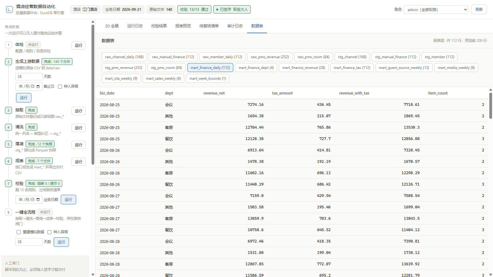
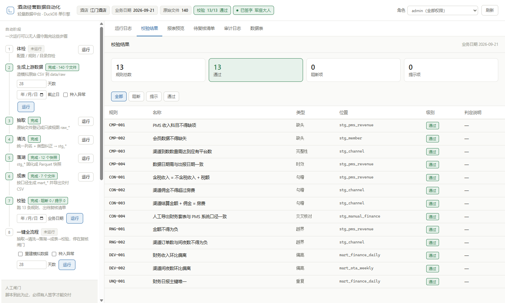
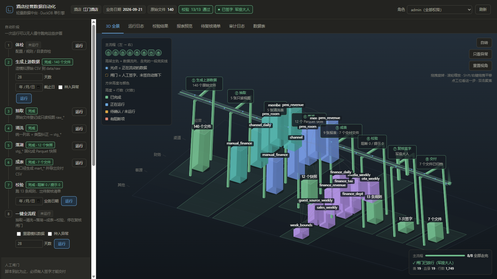

# 01 · 快速开始

## 环境要求

- Python ≥ 3.10（本机验证于 3.13.14）
- 三个依赖：`duckdb`、`PyYAML`、`requests`
- 不需要数据库服务、不需要 Docker、不需要集群。整个中台就是一个目录 + 一个 DuckDB 文件。

## 安装

```bash
cd /d D:\my_code\我的学习\数据中台

python -m venv .venv
.venv/Scripts/python -m pip install --upgrade pip -i https://mirrors.aliyun.com/pypi/simple/
.venv/Scripts/python -m pip install -r requirements.txt -i https://mirrors.aliyun.com/pypi/simple/
```

> **本机踩过的坑**：PyPI 官方源和清华镜像在本机都连不上
> （`SSLEOFError` / `No matching distribution found`），但 **aliyun 和 ustc 镜像是通的**。
> 如果换机器装不上，先试 `-i https://mirrors.aliyun.com/pypi/simple/`。

验证：

```bash
.venv/Scripts/python -c "import duckdb, yaml, requests; print(duckdb.__version__)"
```

## 先体检

```bash
.venv/Scripts/python run.py selftest
```

它会检查四件事：4 份配置文件在不在、13 条规则的类型是不是都有实现、
跨文件引用（`config/settings.yaml#run.deviation_tolerance` 这类）能不能解析、
6 个数据目录能不能建。

任何一项 ✗ 都别往下跑 —— 后面出错会很难定位。

## 跑通全流程

```bash
# 造 28 天模拟上游数据，然后一路跑到复核闸门
.venv/Scripts/python run.py pipeline --regenerate
```

预期输出：

```
① 生成模拟上游数据 ...
   写入 140 个文件，覆盖 2026-08-25 ~ 2026-09-21
② 抽取：登记原始视图 ...
   5/5 个数据源就绪，共 728 行原始数据
③ 清洗：统一列名与类型 ...
   stg_channel              168 行
   stg_manual_finance       112 行
   stg_member               112 行
   stg_pms_revenue          252 行
   stg_pms_room              84 行
④ 落地：湖仓 Parquet 快照 ...
   5 张表已固化
⑤ 成表：按口径生成报表 ...
   业务日期 2026-09-21，产出 7 个交付文件
⑥ 校验：跑全部规则 ...
   规则 13 条：通过 13 / 阻断 0 / 提示 0

⏸  流程已停在复核闸门（这是设计如此：不替财务拍板）。
```

### 看看规则是怎么拦脏数据的

```bash
.venv/Scripts/python run.py pipeline --regenerate --anomalies
```

会在最后一天种入 4 处问题，输出变成：

```
   规则 13 条：通过 9 / 阻断 3 / 提示 1
   ⛔ CMP-001 字段缺失：item、amount_with_tax、amount_net、tax_amount 在 1 行上为空，疑似上游导出不全。
   ⛔ CON-001 勾稽不平：amount_with_tax 与 amount_net + tax_amount 差异合计 500.0 元，共 1 行。
   ⛔ RNG-001 出现负数：amount_with_tax、amount_net、amount_tax 存在负值，最大负值 -678.0。
   ⚠️  DEV-001 环比偏离：2026-09-21 由 29249.98 变为 59213.19，变化 102.44%，超过阈值 30.0%。
```

此时签字会被拒绝：

```bash
.venv/Scripts/python run.py approve --reviewer 张三
# ⛔ 复核闸门：仍有 3 条阻断项未处理，不能批准交付
```

### 走完签字和交付

```bash
# 先生成一份干净数据
.venv/Scripts/python run.py pipeline --regenerate

.venv/Scripts/python run.py review --date 2026-09-21     # 看清单
.venv/Scripts/python run.py approve --reviewer 张三      # 签字
.venv/Scripts/python run.py deliver                      # 归档 + 通知（dry-run）
```

`deliver` 会把 7 个 CSV 复制到 `data/outbox/wecom_drive/2026-09-21/`，
并把要发的企微消息落成 `data/outbox/notifications/*.json`。
因为 `config/delivery.yaml` 里 `webhook_url` 是空的，所以只落盘、不真发。

### 真的发到企业微信

在 `config/delivery.local.yaml`（不进版本库）里填：

```yaml
wecom:
  webhook_url: "https://qyapi.weixin.qq.com/cgi-bin/webhook/send?key=你的key"
```

或者设环境变量 `WECOM_WEBHOOK`。然后 `deliver --send`。

## 常用命令

```bash
python run.py status                       # 当前进展 + 审批状态 + 规则覆盖
python run.py roles                        # 权限矩阵
python run.py ui                           # 起可视化控制台，浏览器自动打开
python run.py extract                      # 单步执行
python run.py transform
python run.py load
python run.py build
python run.py check --date 2026-09-21
python run.py mock --days 7 --as-of 2026-09-21    # 只造 7 天数据
python run.py --role extractor build       # 换个身份跑（会被拒）
python run.py status --json                # 结构化输出
```

调试时设 `HOTEL_DW_DEBUG=1` 可以看完整异常堆栈。

## 可视化控制台

```bash
python run.py ui                    # 默认 127.0.0.1:8777，自动开浏览器
python run.py ui --port 9000        # 换端口
python run.py ui --no-browser       # 不开浏览器（比如在远程机器上）
```

进了页面之后，操作路径就是一个：**在左侧找到那个阶段 → 填参数 → 点「运行」**。
右侧「运行日志」页签会实时把输出刷出来，跟你在终端里看到的一模一样。



「校验结果」页签把 13 条规则的逐条判定摆出来，可以直接按「阻断 / 提示 / 通过」筛：



几个实际用得上的点：

- **顶部「角色」下拉框**决定点「运行」时用谁的身份。
  切成 `extractor` 再去点「复核签字」，会被后端拒绝并提示允许的命令 ——
  跟命令行里 `--role extractor approve` 的结果完全一致。
- **阶段状态不是缓存的**。「完成 · 12 个快照」这种标签是从磁盘和数据库推导出来的，
  所以关了浏览器、重启服务，看到的还是真实状态，不会骗你。
- **一个任务在跑时，所有「运行」按钮会禁用**，后端也会拒绝第二个任务（409）。
- **每个任务的输出都落一份日志**到 `data/logs/ui/`，
  页面上方的任务条可以点回去看历史任务的输出。
- **端口被占会自动顺延**（8777 → 8778 → …），不用手动改。

控制台本身只依赖 Python 标准库（`http.server`）和原生 JS，
没有 Flask、没有 CDN、没有 `npm install`，`pip install` 完就能直接跑。

### 3D 全景（第一个页签）

打开就是一条能转的**流水线**：**从左到右是 8 个工位**
（生成上游 → 抽取 → 清洗 → 落湖 → 成表 → 校验 → 复核签字 → 交付），
**前后是业务域**（经营 / 渠道 / 财务 / 客源与销售 / 其他），
**方块高度是行数**（对数刻度，不然大表会把小表压成一条线）。

上方那条高架主轨就是数据流本身：

- **亮实线的一段** = 已经走完的流程，亮到哪个工位就是走到哪个工位。
- **流动的光点** = 正在流动的数据；有任务在跑时会提速。
- **轨道尽头呼吸的那颗灯** = 流程前沿，也就是**第一个还没走完的工位**。
  HUD 右上角同时给 `6/8` 和「卡在『复核签字』」—— 比例说还剩多少，前沿说卡在哪。
- **工位上转动的圆环** = 这个阶段正在运行。
- **门架处落下的实心拦杆** = 复核闸门拦住了。没签字时轨道会在门前**断开**，
  光点只能在门外堆积 —— 这道门是**拦**在流程上的，数据库里有没有数据都不能替人放行。

其余编码：

- **方块颜色** = 由哪一层产出（原始层青 / 清洗层靛 / 报表层紫）；
  有阻断/提示项会盖成红/琥珀。
- **虚线轮廓** = 这张表没有被任何规则直接覆盖（19 张里有 13 张是这种）。
- **箭头** = 血缘关系，是把 `sql/` 里的语句解析出来的，不是猜的。
- **没有表的工位画成「产物箱」**（生成上游 / 落湖 / 校验 / 签字 / 交付），
  高度同样按数量取对数 —— 它们产出的是快照、结论和凭证，本来就不是表。
  不画箱子的话那几个工位会是一片空地，看起来像没内容。

| 手势 | 效果 |
| --- | --- |
| 拖拽 | 旋转 |
| 滚轮 | 缩放 |
| Shift 拖拽 / 右键拖拽 | 平移 |
| 单击工位 | 看这一步的产物与进度位置，并**就地运行这一阶段** |
| 单击方块 | 选中并在右侧看详情（可以直接跳到「数据表」页签） |
| 双击 | 聚焦到工位 / 这张表 |
| `R` / 空格 / `Esc` | 重置视角 / 自转 / 取消选中 |



刚上手建议就按这个顺序看一遍：先整体转一圈建立空间感 → 从左到右读一遍 8 个工位、
看主轨亮到哪里 → 点「只看异常」看还有哪些表没有规则覆盖 →
点第 7 步「复核签字」，看闸门口径那一栏 —— 那里就是「脚本到此为止、必须有人签字」的位置。

## 接真实数据源

先把 `mock` 关掉 —— 它是为了让链路能跑而存在，接了真数据就不需要了。

### 情况一：已有接口，能自动取数（`mode: auto`）

比如 PMS / 会员系统。两选一：

1. **最省事**：写个脚本把接口数据导出成 `data/raw/pms/revenue_YYYYMMDD.csv`
   （列名按 `config/columns_map.yaml` 的 `canonical`），后面的环节完全不用改。
2. **更彻底**：改 `src/hotel_dw/extract/loader.py`，把 `register_raw_csv`
   换成直连查询（DuckDB 有 `mssql` / `mysql` / `postgres` 扩展），
   只要产出的表名还是 `raw_<table>`，清洗层之后全部不用动。

### 情况二：只能人工导出（`mode: manual`）

比如携程后台、抖音来客。保持「人工导出 + 统一导入」，这是简报里明确的过渡路线。
运营导出后需要三件事：

1. **改列名**：按 `config/columns_map.yaml` 里对应平台的映射，改成中台统一列名
2. **改文件名**：`<业务>_<YYYYMMDD>.csv`，比如 `channel_20260921.csv`
3. **放目录**：`data/raw/manual/`

约定要守住（`config/data_sources.yaml → import_conventions`）：
UTF-8 编码、逗号分隔、金额两位小数不带千分位和货币符号、
不要合并单元格、**不要带合计行**（合计由中台算，上游只给明细）。

上游给了合计行会怎样？会被当成一条普通明细累加进收入 → 收入翻倍 → `UNQ-001` 和
`DEV-001` 大概率会报警，但最好一开始就别这么导。

### 新增一个数据源

1. 在 `config/data_sources.yaml` 加一个 `sources[]` 条目，写清 `key` / `mode` / `files[]`
2. 在 `config/columns_map.yaml` 补列名映射
3. 在 `sql/staging/` 加一个 `stg_<新源>.sql`（照抄现有的，只换列名和表名）
4. 在 `config/report_rules.yaml` 的 `validation` 里补几条针对它的规则
5. `python run.py selftest && python run.py pipeline`

程序一行都不用改。

## 常见问题

**跑 `transform` 报 `Table with name raw_xxx does not exist`**
原始 CSV 没找到。先 `run.py extract` 看哪个源是 `×`，再检查文件名和目录是否符合
`data_sources.yaml` 里的 `glob`。

**`CMP-004` 报「数据滞后」**
`max(biz_date)` 距今天超过 1 天了。用模拟数据时 `mock` 默认生成到今天；
如果用的是固定日期的数据，要么重跑 `mock`，要么把 `max_lag_days` 调大
（但这等于主动关掉「静默失败」的探测器，慎用）。

**`approve` 被拒绝**
说明还有阻断项。跑 `run.py review` 看具体是哪几条。
处理完数据重跑管道；如果确认是规则本身要改，改 `config/report_rules.yaml`
并在提交信息里写清为什么 —— 这是口径变更，不是随手改参数。

**`deliver` 报「报表内容在审批之后发生了变化」**
审批之后有人改过 CSV。这是设计行为：审批凭证绑定的是报表内容。
重跑 `build`（内容一致则指纹自动恢复）→ `check` → `approve` → `deliver`。

**Excel 打开 CSV 中文乱码**
不该发生 —— 交付 CSV 都带 UTF-8 BOM（`db.Warehouse.to_csv` 会补）。
如果乱码，说明你看的是 `data/lakehouse/` 或 `data/raw/` 里的文件，那些刻意不带 BOM
（给机器读的）。

**重跑会不会重复计收入**
不会。所有表都是 `CREATE OR REPLACE TABLE`，交付文件是覆盖写。
`UNQ-001` 就是专门盯这件事的：主键重复直接阻断。
